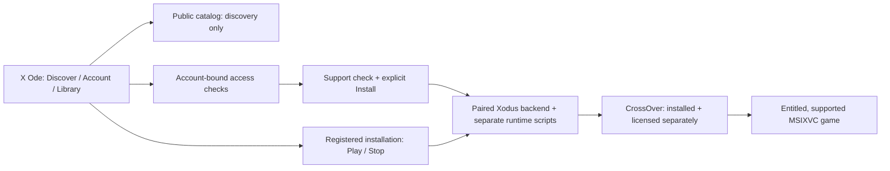

# X Ode

A native macOS interface for legitimately entitled Xbox PC games, powered by
the Xodus backend and **separately installed, licensed CrossOver**.

**Experimental; not a public release.** The launch focus is the CrossOver-backed
MSIXVC path. No Man's Sky single-player is owner-confirmed, not independently
retested here and not a promise that every Xbox PC game works. Catalog visibility,
ownership, package support and successful Mac gameplay are separate facts.

## Source adoption, not distribution clearance

This private integration branch adopts the complete frozen native app source at
[`784dedf517845e0caf4cdedcd032444cddaa3d2a`](https://github.com/dragoshont/xodus-macos-app/commit/784dedf517845e0caf4cdedcd032444cddaa3d2a),
including its stabilization history, without changing app code, tests, package
manifest, tools, design or CI. It preserves the seven documentation/bootstrap
commits on `main`; adoption remains a draft proposal until merged.
This is not merely a six-fix patch or a release.

The [issue ledger](docs/ISSUE-LEDGER.md) and
[game-test ledger](docs/GAME-TEST-LEDGER.md) are frozen snapshots from
`eb07537dc9cd1bead01780b66366f1664492eb22`, not live reports. Source checks,
parent-observed signed-package acceptance and title-specific gameplay remain
separate evidence. [Launch readiness](docs/LAUNCH-READINESS.md) retains the
earlier recovery record and release holds.

## What the UI can do

These are source-backed capabilities, not a claim that every action is accepted
on the newest package. [Native integration](docs/NATIVE-INTEGRATION.md) and
[verification evidence](docs/VERIFICATION.md) retain the source branch's detailed,
dated observations; historical entries are not fresh acceptance.

| Area | Available interface | Important boundary |
| --- | --- | --- |
| Discover / search | Browse PC Game Pass candidates, search Store games, show loaded owned matches first, open details | Public results and artwork do not grant ownership or Mac compatibility; search coverage is partial |
| Account / library | Explicit sign-in, account-bound PC library, Game Pass status check, Installed and Continue Playing | Management, Store/PC-library and game-service accounts are separate; subscription access can expire |
| Install / downloads | Check support, confirm destination and space, show backend progress, cancel | Requires an entitled supported package and the paired runtime; Install never auto-plays |
| Play / Stop | Launch a registered installed game; request Stop for the tracked title | Runtime and title-specific qualification still apply; ordinary Quit does not stop gameplay |
| Repair / update / remove | Explicit runtime repair, Check for update / Repair, confirmed Uninstall, separate Remove from list | List removal does not delete files; save preservation needs exact-runtime acceptance |
| Additional source seams | M1/M3 package/routing rules; M7 queue controls and version comparison; M10 account tiers | Included in the frozen source, not generally game-qualified by adoption |



### Visual reference, not gameplay evidence


**Historical fixture mockup, not a current app or game screenshot.** The image
uses fictional titles and original illustrations; its access labels are invented.
It retains the earlier Xodus name. It was inspected for account names, emails and
tokens; none were visible. No live account capture or copyrighted game art is
republished. [Artwork provenance](Sources/XodusPreview/Resources/Artwork/PROVENANCE.json).
The offline demonstration and fictional artwork are nonshipping only;
`XODUS_SHIPPING=1` excludes their views, resources and check/export entrypoints.

## Before you try it

Use an Apple Silicon Mac. The [package manifest](Package.swift)
and [app manifest](tools/Info.plist) declare **macOS 14 minimum**; that is not
fresh-Mac certification across 14-26. Development checks require Xcode/macOS
SDK 27 or newer, macOS runtime 27 or newer and Swift 6.4.
Gameplay also needs official CrossOver, a matching reviewed Xodus engine/runtime,
legitimate game entitlement and explicit human sign-in/Keychain consent.
CrossOver detection does not verify its license or certify a game.

**Installation:** no public installer is recommended yet. Use only an
independently admitted, source-matched package with rollback preserved; close the
app normally and ensure games and mutations have ended before replacement.
Never force Quit to bypass an installation hold, disable macOS protections, or
replace the credential helper silently. See the [release checklist](docs/LAUNCH-READINESS.md#release-checklist).

### Build the frozen UI source (macOS only)

For the preserved, exact app source, use a separate source checkout:

```sh
git clone --branch dragoshont-x-ode-app-stabilization https://github.com/dragoshont/xodus-macos-app.git x-ode-source
cd x-ode-source
git checkout --detach 784dedf517845e0caf4cdedcd032444cddaa3d2a
swift build --product XodusPreview
sh tools/check.sh
```

`XodusPreview` is the retained executable name. Building does not install, sign,
launch a game or produce an admitted release. Shipping packaging requires the
reviewed engine/provenance hashes, exact source/tree, explicit signing identity
and helper receipts accepted by [tools/build_app.sh](tools/build_app.sh);
do not guess inputs or distribute an unpaired build.

The [immutable package recovery handoff](https://github.com/dragoshont/xodus-macos-app/blob/d60863e8323da6920a0f0650cf0e45e0d2038134/docs/PAUSE-HANDOFF.md)
records `fac58d6` deployed after `02e67f8`, superseding the early Quit hold.
Later parent-observed acceptance of exact `784dedf` is recorded in the frozen
ledgers; neither historical recovery nor that bounded acceptance is a public
installer or multiplayer qualification.

## Scope and credits

Wine/GPTK/custom graphics remain experimental, not the first-release path.
Heroic integration, Cuphead/Celeste success, UWP/EAppx gameplay and online
multiplayer are **not launch claims**. Broader support and additional release
work are paused pending the bounded CrossOver launch qualification. Documentation
does not hide or disable existing controls.

X Ode builds on [Xodus](https://github.com/xodus-gaming/xodus) and the
[macOS backend fork](https://github.com/dragoshont/xodus-macos).
Original app source, documentation and mockups are **GPL-3.0-only**; preserve
[the source license](LICENSE), [licensing boundaries](docs/LICENSING.md),
upstream notices and corresponding-source obligations when distributing.
CrossOver, games and other third-party components retain their own terms; GPL
does not authorize redistribution of proprietary packages or credentials.
Component acquisition, backend-source provenance and redistribution/legal holds
[#28](https://github.com/dragoshont/xodus-macos-app/issues/28) and
[#38](https://github.com/dragoshont/xodus-macos-app/issues/38) remain open.
No runtime/component binaries, Wine/CrossOver/Windows code or XCurl adapter are
introduced by this source adoption.

This is an independent project, not affiliated with or endorsed by Microsoft,
Xbox, Apple, CodeWeavers or game publishers. **X Ode** is the documentation
product name; bundle identifiers, Keychain identities, signer requirements and
existing Xodus paths are unchanged.

Backend scope and launch boundaries: [coordinator regrouping notes](https://github.com/dragoshont/xodus-macos/blob/dragoshont-heroic-xbox-integration/docs/xodus/regrouping.md)
and [publication precautions](https://github.com/dragoshont/xodus-macos/blob/dragoshont-heroic-xbox-integration/docs/xodus/publication.md).
