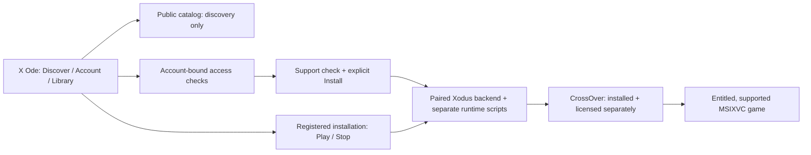

# X Ode

A native macOS interface for legitimately entitled Xbox PC games, powered by
the Xodus backend and **separately installed, licensed CrossOver**.

**Experimental; not a public release.** The launch focus is the CrossOver-backed
MSIXVC path. No Man's Sky single-player is owner-confirmed, not independently
retested here and not a promise that every Xbox PC game works. Catalog visibility,
ownership, package support and successful Mac gameplay are separate facts.

## What the UI can do

These are source-backed capabilities, not a claim that every action is accepted
on the newest package. [Launch readiness](docs/LAUNCH-READINESS.md) separates
historical deployments, recovered package receipts and current unknowns.

| Area | Available interface | Important boundary |
| --- | --- | --- |
| Discover / search | Browse PC Game Pass candidates, search Store games, show loaded owned matches first, open details | Public results and artwork do not grant ownership or Mac compatibility; search coverage is partial |
| Account / library | Explicit sign-in, account-bound PC library, Game Pass status check, Installed and Continue Playing | Store-library and game-service sign-in are separate; subscription access can expire |
| Install / downloads | Check support, confirm destination and space, show backend progress, cancel | Requires an entitled supported package and the paired runtime; Install never auto-plays |
| Play / Stop | Launch a registered installed game; request Stop for the tracked title | Runtime and title-specific qualification still apply; ordinary Quit does not stop gameplay |
| Repair / update / remove | Explicit runtime repair, Check for update / Repair, confirmed Uninstall, separate Remove from list | List removal does not delete files; save preservation needs exact-runtime acceptance |
| Newer source only | M1/M3 package/routing rules; M7 queue controls and version-comparison seams; M10 account tiers | Merged into the source branch, not `main`; neither installed nor generally game-qualified by that merge |



### Visual reference, not gameplay evidence


**Historical fixture mockup, not a current app or game screenshot.** The image
uses fictional titles and original illustrations; its access labels are invented.
It retains the earlier Xodus name. It was inspected for account names, emails and
tokens; none were visible. No live account capture or copyrighted game art is
republished. [Artwork provenance](https://github.com/dragoshont/xodus-macos-app/blob/fac58d6f501c356a0e763d397263e5a0a30b3477/Sources/XodusPreview/Resources/Artwork/PROVENANCE.json).

## Before you try it

Use an Apple Silicon Mac. The [package manifest](https://github.com/dragoshont/xodus-macos-app/blob/fac58d6f501c356a0e763d397263e5a0a30b3477/Package.swift)
and [app manifest](https://github.com/dragoshont/xodus-macos-app/blob/fac58d6f501c356a0e763d397263e5a0a30b3477/tools/Info.plist)
declare **macOS 14 minimum**; that is not fresh-Mac certification across 14-26.
Development evidence uses Xcode/macOS SDK 27 or newer and Swift 6.4.
Gameplay also needs official CrossOver, a matching reviewed Xodus engine/runtime,
legitimate game entitlement and explicit human sign-in/Keychain consent.
CrossOver detection does not verify its license or certify a game.

**Installation:** no public installer is recommended yet. Use only an
independently admitted, source-matched package with rollback preserved; close the
app normally and ensure games and mutations have ended before replacement.
Never force Quit to bypass an installation hold, disable macOS protections, or
replace the credential helper silently. See the [release checklist](docs/LAUNCH-READINESS.md#release-checklist).

### Build the pinned UI source (macOS only)

`main` and this documentation branch do **not** contain the Swift app. Development
source lives on [`dragoshont-xodus-app-foundation`](https://github.com/dragoshont/xodus-macos-app/tree/dragoshont-xodus-app-foundation).
For the pinned historical package source, use a separate source checkout:

```sh
git clone --branch dragoshont-xodus-app-foundation https://github.com/dragoshont/xodus-macos-app.git x-ode-source
cd x-ode-source
git checkout --detach fac58d6f501c356a0e763d397263e5a0a30b3477
swift build --product XodusPreview
sh tools/check.sh
```

`XodusPreview` is the retained executable name. Building does not install, sign,
launch a game or produce an admitted release. Shipping packaging requires the
reviewed engine/provenance hashes, exact source/tree, explicit signing identity
and helper receipts accepted by [`tools/build_app.sh`](https://github.com/dragoshont/xodus-macos-app/blob/fac58d6f501c356a0e763d397263e5a0a30b3477/tools/build_app.sh);
do not guess inputs or distribute an unpaired build.

The [immutable package recovery handoff](https://github.com/dragoshont/xodus-macos-app/blob/d60863e8323da6920a0f0650cf0e45e0d2038134/docs/PAUSE-HANDOFF.md)
records `fac58d6` deployed after `02e67f8`, superseding the early Quit hold.
The current app's source identity remains unestablished; recovered receipts are
not a public installer or fresh gameplay qualification.

## Scope and credits

Wine/GPTK/custom graphics remain experimental, not the first-release path.
Heroic integration, Cuphead/Celeste success, UWP/EAppx gameplay and online
multiplayer are **not launch claims**. Broader support and additional release
work are paused pending the bounded CrossOver launch qualification. Documentation
does not hide or disable existing controls.

X Ode builds on [Xodus](https://github.com/xodus-gaming/xodus) and the
[macOS backend fork](https://github.com/dragoshont/xodus-macos).
Original app source, documentation and mockups are **GPL-3.0-only**; preserve
[the source license](https://github.com/dragoshont/xodus-macos-app/blob/fac58d6f501c356a0e763d397263e5a0a30b3477/LICENSE),
[licensing boundaries](https://github.com/dragoshont/xodus-macos-app/blob/fac58d6f501c356a0e763d397263e5a0a30b3477/docs/LICENSING.md),
upstream notices and corresponding-source obligations when distributing.
CrossOver, games and other third-party components retain their own terms; GPL
does not authorize redistribution of proprietary packages or credentials.

This is an independent project, not affiliated with or endorsed by Microsoft,
Xbox, Apple, CodeWeavers or game publishers. **X Ode** is the documentation
product name; bundle identifiers, Keychain identities, signer requirements and
existing Xodus paths are unchanged.

Backend scope and launch boundaries: [coordinator regrouping notes](https://github.com/dragoshont/xodus-macos/blob/dragoshont-heroic-xbox-integration/docs/xodus/regrouping.md)
(publication pending at this snapshot; destination reserved by the backend owner).
