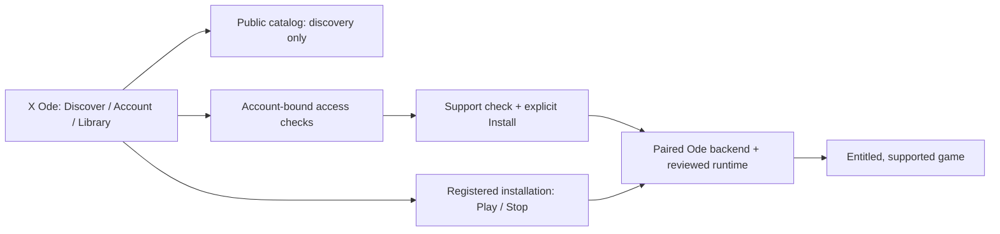

# X Ode

By Working Principle · Beta

A native macOS interface for legitimately entitled Xbox PC games, powered by
the Ode backend and separately installed runtimes.

**Experimental; not a public release.** Catalog visibility, account access,
package support and successful Mac gameplay are separate facts. A verified app
signature or an installed game folder does not establish entitlement or
compatibility.

## What the UI can do

These are source-backed capabilities, not a claim that every action is accepted
on the newest package. [Launch readiness](docs/LAUNCH-READINESS.md) separates
historical deployments, recovered package receipts and current unknowns.

| Area | Available interface | Important boundary |
| --- | --- | --- |
| Discover / search | Browse PC Game Pass candidates, search Store games, show loaded owned matches first, open details | Public results and artwork do not grant ownership or Mac compatibility; search coverage is partial |
| Account / library | Explicit sign-in, account-bound collections, background access checks for known installed Store IDs, Installed and Continue Playing | Permission does not identify ownership or subscription acquisition; uninstalled account-wide Game Pass enumeration is unresolved |
| Install / downloads | Check support, confirm destination and space, show backend progress, cancel | Requires an entitled supported package and the paired runtime; Install never auto-plays |
| Play / Stop | Launch a registered installed game; request Stop for the tracked title | Current account access and runtime/title-specific qualification still apply; ordinary Quit does not stop gameplay |
| Repair / update / remove | Explicit runtime repair, Check for update / Repair, confirmed Uninstall, separate Remove from list | List removal does not delete files; save preservation needs exact-runtime acceptance |

Library checks known installed products automatically and retains still-valid
access facts while renewing them. Expiry, sign-out and account changes withdraw
permission. Installed records without confirmed access remain separately
manageable; they are not relabelled Owned or Game Pass.

The latest private local candidate has bounded live evidence for 36 installed
products and renewal across the original cache boundary. That is not general
gameplay certification, offline permission or a public distribution approval.
Library scrolling and tab-switch responsiveness are under separate UX and
performance review.



### Visual reference, not gameplay evidence


**Historical fixture mockup, not a current app or game screenshot.** The image
uses fictional titles and original illustrations; its access labels are invented.
It retains the earlier product name. It was inspected for account names, emails and
tokens; none were visible. No live account capture or copyrighted game art is
republished. [Artwork provenance](https://github.com/WorkingPrinciple/xode-ui/blob/fac58d6f501c356a0e763d397263e5a0a30b3477/Sources/XodusPreview/Resources/Artwork/PROVENANCE.json).

## Before you try it

New game installations default to `~/Games/Xode`. Saved custom installation
roots and partial-install destinations are retained; this source change does not
move existing games. Discovery also recognizes the library roots earlier builds used.

Use an Apple Silicon Mac. The package and app manifests declare macOS 14 minimum;
that is not fresh-Mac certification across supported operating systems.
Development evidence uses Xcode/macOS SDK 27 or newer and Swift 6.4.
Gameplay needs a matching reviewed Ode engine/runtime, legitimate game
entitlement and explicit human sign-in/Keychain consent. Calimocho is the
default engine and can be installed from inside X Ode. CrossOver is optional;
X Ode detects an installed copy, but detection does not verify its license or
certify a game. Other Wine/graphics recipes remain experimental.

**Installation:** use the X Ode DMG installer and keep a rollback copy before
replacing an existing build. Close the app normally and ensure games and
mutations have ended before replacement. Never force Quit to bypass an
installation hold, disable macOS protections, or replace the credential helper
silently. See the [release checklist](docs/LAUNCH-READINESS.md#release-checklist).

### Build the UI source (macOS only)

The Swift app source is included on `main`:

```sh
git clone https://github.com/WorkingPrinciple/xode-ui.git x-ode-source
cd x-ode-source
swift build --product OdePreview
sh tools/check.sh
```

`OdePreview` is the retained executable name. Its default is the native live
development shell, not simulated gameplay. The original fixture demonstration
is nonshipping only. Building does not install, sign, launch a game or produce
an admitted release. Shipping packaging requires reviewed engine/provenance
hashes, exact source/tree, explicit signing identity and helper receipts accepted
by [the packager](tools/build_app.sh); do not guess inputs or distribute an
unpaired build. See [controlled pair admission](docs/SHIPPING-ADMISSION.md).

## Reference and limitations

- [Product](PRODUCT.md), [design](DESIGN.md) and [UX flows](docs/UX-FLOWS.md)
- [Architecture](docs/ARCHITECTURE.md) and [backend contract](docs/BACKEND-CONTRACT.md)
- [Native integration](docs/NATIVE-INTEGRATION.md) and [verification](docs/VERIFICATION.md)
- [Runtime providers](docs/RUNTIME-PROVIDERS.md) and [launch readiness](docs/LAUNCH-READINESS.md)

The in-app Calimocho installer and allowlisted runtime resource bundle are
included. The DMG includes a hash-bound `RESOURCE-INVENTORY.json`. Catalogue
projections and private-origin evidence remain subject to redistribution
review; merging source does not clear those rights. Install/cancel/resume
acceptance on the latest candidate remains incomplete without an eligible
uninstalled test target. Broader gameplay, online multiplayer, notarization and
distribution need separate evidence. Heroic integration, Cuphead/Celeste
success and UWP/EAppx gameplay are not launch claims. Documentation does not
hide or disable existing controls.

## What X Ode may ask permission for, and why

macOS asks the first time each one is needed, never all at launch. Before Find consoles and before the first ready-to-play notice, X Ode explains what macOS is about to ask; choosing Not now skips the prompt, and Settings ▸ Permissions offers Ask Now later. Windows games run through X Ode, so a prompt a game triggers names X Ode.

| Permission | When and why | When macOS asks |
|---|---|---|
| Local network | X Ode and the games it runs use your local network to find Xbox consoles and for multiplayer features. | Only after you choose Find consoles and X Ode explains the search; a game may use it when you start a feature that needs it. |
| External drives | When X Ode stores games on an external drive, or a game it runs reads or saves files there. | When X Ode or a game it runs first reads or writes a folder or drive you chose here. |
| Network drives | When X Ode stores games on a network drive, or a game it runs reads or saves files there. | When X Ode or a game it runs first reads or writes a folder or drive you chose here. |
| Documents folder | When X Ode stores games in your Documents folder, or a game it runs reads or saves files there. | When X Ode or a game it runs first reads or writes a folder or drive you chose here. |
| Downloads folder | When X Ode stores games in your Downloads folder, or a game it runs reads or saves files there. | When X Ode or a game it runs first reads or writes a folder or drive you chose here. |
| Desktop folder | When X Ode stores games on your Desktop, or a game it runs reads or saves files there. | When X Ode or a game it runs first reads or writes a folder or drive you chose here. |
| Notifications | After a game finishes installing, so X Ode can tell you it's ready to play. Never at launch. | After the first game install or repair finishes and X Ode explains why; never at launch. |
| Keychain | When X Ode checks or saves your Microsoft sign-in on this Mac. | When you sign in, or after X Ode explains it and you choose Approve Keychain access. |

To change an answer, use System Settings ▸ Privacy & Security for local network and folders, and System Settings ▸ Notifications for notifications. X Ode also shows an Open System Settings button next to a problem it can fix. Keychain asks separately for each saved sign-in; there's no System Settings switch for it. If X Ode says local network access is off right after the prompt appeared, answer the prompt, then choose Find consoles again.

In-game voice chat and microphone input aren't supported in this beta. Developer ID–signed releases keep the same app identity, so permissions you already granted and your saved sign-in carry over between them.

## Scope and credits

X Ode runs Windows games with [Wine](https://www.winehq.org) (LGPL-2.1-or-later; thank you to the Wine authors and CodeWeavers) and is built on [Xodus](https://github.com/xodus-gaming/xodus) (GPL-3.0; thank you to its contributors).

External engine-provider credits: [Highball](https://github.com/gauthierpiarrette/highball) (GPL-3.0; User-installed Wine engine provider); [CrossOver](https://www.codeweavers.com/crossover) (Proprietary; Commercial Wine distribution by CodeWeavers). These are external provider credits only: users install them separately. They are not bundled or installed by X Ode, and listing them does not imply game compatibility.

In the app, the credits and every component's licence are in X Ode menu › Acknowledgments
(or Open-Source Licences…, and Help › Acknowledgments and Licences). They work signed out and offline.

X Ode's backend is the [macOS backend fork](https://github.com/WorkingPrinciple/xodus-macos) of Xodus.
Original app source, documentation and mockups are GPL-3.0-only; preserve
[the source license](LICENSE), [NOTICE](NOTICE), [licensing boundaries](docs/LICENSING.md),
upstream notices and corresponding-source obligations when distributing. The
X Ode and Working Principle names and logos aren't licensed by the GPL; see
[TRADEMARKS](TRADEMARKS.md).
CrossOver, games and other third-party components retain their own terms; GPL
does not authorize redistribution of proprietary packages or credentials.

This is an independent project, not affiliated with or endorsed by Microsoft,
Xbox, Apple, CodeWeavers or game publishers. X Ode is the product name shown in
the app (one source: `AppBrand` in `Sources/OdeCore/AppBrand.swift`); bundle
identifiers, executables, module names, preference keys, Keychain identities,
signer requirements and data paths use the Ode names ([rename record](docs/ODE-RENAME.md)).

Backend scope and launch boundaries: [coordinator regrouping notes](https://github.com/WorkingPrinciple/xodus-macos/blob/dragoshont-heroic-xbox-integration/docs/xodus/regrouping.md)
and [publication precautions](https://github.com/WorkingPrinciple/xodus-macos/blob/dragoshont-heroic-xbox-integration/docs/xodus/publication.md).
