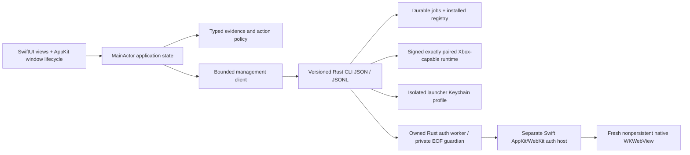

# Architecture

## Boundary

**Implemented:** SwiftPM `XodusCore` typed evidence/fixture policy, a supervised
`XodusManagement` JSONL client, the live `XodusPreview` SwiftUI/AppKit shell,
dependency-free native checks and original scene resources. Explicit fixture
mode never connects an engine. The separately staged `XodusAuthHost` executable
has no management-module dependency; it owns native browser callbacks and the
strict private seven-string handoff, not credentials in the main application.
Its source/headless checks are not a deployed producer pairing or successful
human authentication. Optional explicit exports write only this app's own views.

**Future/gated:** authoritative inventory, authorized installation and a signed,
exactly paired gameplay runtime. Existing `xodus-service` runtime IPC is not
account/catalog/install/queue management. No private Rust source is imported.

## Model and ownership

### Retained native browse presentation

Library and Discover retain bounded derived projections in their app-owned tab
selection objects. A semantic input key includes account identity/currentness,
installed records, actual permitted IDs (Library), catalogue data, compatibility,
metadata revision, query and filters. Equal inputs reuse joins, localized sorts,
hero selection and ID indexes; scroll and hero selection do not rebuild them.
Account retirement clears private projections. Actual current-time permission,
300-second TTL, licence expiry and the action/final-launch guards remain live,
not memoized authority. Accepted licence expiry is parsed once per fact.

Visited Library and Discover hosts survive navigation within the same account
and locale, including their image presentations and independent scroll views.
Inactive hosts are disabled, excluded from hit testing and accessibility, and
stop carousel/video, polling and scheduling optional artwork/metadata work.
Already-shared bounded reads may finish for surviving consumers. Unvisited tabs
do not start loads merely to retain a host. Account/locale changes replace the
hosts. Each tab keeps its filter/genre, sort, hero and stable grid scroll target.
Scroll targets are non-published restoration values: row crossings update the
ScrollView binding without invalidating the tab's observed selection and body.
Automatic hero paging also requires visible media, no hero keyboard focus,
VoiceOver off and normal power; existing active-tab/scene, modal, hover, playback
and Reduce Motion gates remain independent. Without viewport visibility support,
automatic paging stays off. Continue Playing's See All applies Installed/recent
ordering and reveals the collection using its existing scroll route.
Collection filters and compatibility/query scope do not alter the curated hero
or Continue Playing membership/order. Those use the qualified, recommendable
library and live launchability, not filtered grid rows. A native next-game
chevron advances the existing horizontal lane position. The collection header
has a sibling scroll-target layout, separate from the grids so card targets
remain registered. Continue Playing's horizontal ScrollView uses intrinsic vertical
sizing from its cards, including natural text and error heights; its cross-axis
extent must not absorb the grid's changing vertical proposal. Filter and
compatibility actions preserve surviving targets and clear removed card targets
without forcing a header or card position. When controls are visible away from
the native top, an explicit action reserves only the document extent required
for the measured offset: offset plus current container height minus bottom inset.
This top-aligned minimum sits at the outer content seam, not under the results;
it does not retain the previous full document height. Each action replaces the
reservation, height resizing recalculates it, and width reflow ignores it.
Width capture and invalidation use the native container's local width, not a
global-frame subtraction. Comparisons allow four floating-point ULPs of
representation noise; a real width change still retires the reservation.
Hero/top actions, See All and a completed user scroll to native top release it.
See All uses the same ID
binding, not a competing scroll proxy. Only explicit actions publish a local
position-command revision; live scroll IDs and header/viewport geometry remain
plain storage. Only explicit scope/navigation actions and completed user top
navigation publish the extent. No size-change anchor reset, deferred scroll or
blanket viewport-height results filler is applied. Native extent preservation
requires macOS 15 scroll geometry; macOS 14 has no invented offset fallback.
The retained root subscribes to distinct action-extent publications through its
existing local command revision, including release after deliberate top navigation;
the AppState does not forward nested LibrarySelection changes automatically.
Native Minecraft's separate local-launcher card appears only under All/Installed,
never as invented Owned or Game Pass evidence.
Public DisplayCatalog ProductType/ProductKind classify base games independently
of collection row kind and Windows package availability. Explicit Game evidence
plus PC package evidence admits a game; explicit applications/addons and other
known non-base-game kinds are excluded. Missing, malformed, unknown or conflicting
public kind/type stays unresolved, not an empty library or a definitive exclusion.
Discover cards and genre navigation use the same public classification and keep
unclassified descriptor IDs eligible for loading with an incomplete-results notice.
Management stderr retains only the exact count-only `Ode collection read` line,
framed across chunks with a 512-byte line bound and the existing total-byte cap.
Unified logging supplies capture time; a local read ordinal identifies the sole
library request pending at capture, not a producer-supplied correlation ID.
Without exactly one pending library request, the line is explicitly uncorrelated.
No account, product, token or raw request identifiers are logged.
Ambient artwork retains the outgoing image/palette during same-context hero
replacement; a new context starts with a dark hero backing, never old-account
artwork. Foreground landscape images remain keyed to their requested game.
Local installed registry loading precedes the remote
collection wait. Empty Discover entry starts immediately; typed queries retain
the 250 ms debounce. Same-scope/query public refresh keeps useful products while
loading; explicitly failed IDs may retain prior descriptors with failure state.
Changing scope/query clears wrong-key content.

Public metadata publishes one image/fact revision per response batch (at most
20 products), retains useful earlier results on failure, coalesces same-key
selected details and serializes bulk waiters. Locale changes advance a generation
so A-to-B-to-A cannot admit an obsolete A completion. Selected-detail priority
remains independent of blocked bulk work. These are public descriptors, never
PC membership, ownership or permission.
Acquisition presentation uses all three acquisition kinds: only purchased games
enter Owned; subscriptions retain their distinct label, and unknown held games
say "In your library". Unknown provenance does not remove current held access or
independent install/play authority. Account tiers/counts, search, projections and
detail use the same distinction; public catalog membership grants no authority.
Unavailable/incomplete account collection and unknown acquisition are explicit
in Owned, not a definitive empty purchased library. Unified collection loading
waits at most 30 seconds for the existing account-read admission to become idle,
with cancellation/generation/account fencing; it does not change authentication,
issued-request deadlines or retry a dispatched request. Sanitized counts record
dispatch, acquisition kinds and unresolved/excluded PC descriptors.
Ordinary detail content follows system appearance; dark treatment is local to
the media header. See [native UI procedures](NATIVE_UI_PROCEDURES.md) for bounded
real-product verification and evidence limits.
Response decoding and detail/artwork/commerce normalization run in one
cancellation-linked utility task, returning a Sendable batch. The MainActor
rechecks cancellation and generation before one coherent publication; optional
detail and commerce rejections remain explicit and do not withdraw game access.

Reproduce the isolated CPU-preparation comparison with
`swift build --product XodusPreview --jobs 1` followed by
`swift run --skip-build XodusPreview --presentation-performance-check`.
On Apple M5 Max, macOS 27.0.1, Swift 6.4, debug build, 20 samples per cell:

| Synthetic titles | Original Discover p95 ms | Indexed cold p95 ms | Retained warm p95 ms |
| --- | ---: | ---: | ---: |
| 36 | 0.796 | 0.162 | 0.017 |
| 300 | 45.598 | 0.992 | 0.137 |
| 512 | 132.722 | 1.619 | 0.233 |
| 565 | 160.897 | 2.035 | 0.269 |

The original-path fixture reconstructs search results and scans installed
records per card; the new path uses the production projection and indexes.
All three paths produce the same checksum. A warm evaluation builds no
projection; a 20-product metadata response produces one revision. These are
synthetic data preparation measurements, **not** SwiftUI rendering, trackpad
scrolling, tab-switch latency, hitch ratio, production cache traffic or deployed
app acceptance. The 565 fixture does not extend the 512 wire/aggregate bound.

### Shared public descriptors and useful partial collection loading

Collection resolution and Library artwork/details share a credential-free
DisplayCatalog descriptor actor. Keys include StoreID, normalized market and
case-normalized language. Validated raw public product records expire after
300 seconds; reusable entries are bounded independently at 512 records and
32 MiB. This memory bound does not raise collection/transport aggregate limits.
Requests and reconstructed responses retain the existing 20-product/4 MiB
bounds. Eviction means fetch again, not missing metadata. Active per-ID tasks
are separate from reusable entries, and cancelling a consumer does not cancel
another consumer's shared read. Missing/failed/invalid records are not negatively
cached. Artwork's freshness uses the shared record expiry, not a renewed TTL
for a near-expired cache hit. Retained images remain visible on failed refresh.

A validated authoritative collection starts a generation-bound resolution;
each completed public batch publishes useful PC records without waiting for
later batches. Missing descriptors, unknown platforms and failed batches remain
explicitly unresolved, not non-PC exclusions or invented PC membership. A
partial result is not current account access. Existing PC title/artwork can
remain only for unresolved IDs still in that same account's current collection;
acquisition kind comes from the current collection, never the retained snapshot.
Only authoritative collection IDs determine removals. Total descriptor failure
remains an error; partial state remains visible as incomplete. Both legacy and
unified controllers fence progress by generation; the unified path additionally
checks the current confirmed account. Public descriptor sharing is not an
account cache, licence cache or permission source.

The isolated `--library-access-check` fixture compares the former independent
collection/artwork fetch paths with shared reuse. At 36/300/512 titles, public
request counts fall from 4/30/52 to 2/15/26. A 21-title fixture publishes its
first 20 PC records before the failing second batch and retains one unresolved
candidate. Checks cover cancellation, expiry, locale A-to-B-to-A publication,
retry, eviction with active waiters, authoritative removal, current acquisition
kind and late completion after account retirement. These are synthetic transport
operation counts, not real Wi-Fi latency or authenticated scrolling evidence.
No 565-title wire-coverage claim is made.
For a fresh checkout, build the isolated management helper first:
`swift build --product XodusManagementChecks --jobs 1`, then
`swift build --product XodusPreview --jobs 1` and
`swift run --skip-build XodusPreview --library-access-check`.
The shipping Library embeds the same partial-resolution notice outside the
legacy pane's collection-grid flag; a failed partial refresh never claims to
show a complete prior library.

### Target-sized artwork

Artwork chooses a 640/1280/2400 maximum-pixel bucket from rendered size, backing
scale and source aspect ratio (including fill versus fit cropping). Zero-size
layout requests no image; hero decoding remains capped at 2400. Bitmap identity
includes validated URL, bucket and processing version. Concurrent variants
coalesce the encoded byte read by URL; decode is per variant, not per card.
Only two fetch/decode pipelines run at once. The existing 64 MiB/40-bitmap
NSCache is charged `CGImage.bytesPerRow * height`, not NSImage point dimensions.
Admission queues at most 64 jobs; excess requests surface the ordinary artwork
unavailable state. Each shared variant tracks its live consumers. Losing the
last consumer cancels its queued admission immediately; withdrawing one of
several consumers does not cancel their shared work. An already-running public
byte read may finish within its existing HTTP timeout, but a retired variant
does not continue into decode or publication.
HTTP expiry/no-store, redirects, approved URLs, MIME, byte and pixel bounds
remain enforced. Disk writes follow successful decode; corrupt disk data can
retry the real public URL. Memory-clear generations fence stale writes.

Presentation reads also check the current URL/variant before displaying a
bitmap, so a previous game's image cannot flash while a new task starts.
Same-key revalidation retains its useful image; late responses cannot replace
another request's presentation. Cancelling one consumer does not cancel shared
fetch/decode work.

Non-GUI inspection compiled the production shipping source set with a private
entry point and the default production URLSession, then fetched real Microsoft
Digging artwork without credentials or a production disk cache. The real
640 and 1280 variants decoded to 640x360 (921,600 bytes) and 1280x720
(3,686,400 bytes), shared one URL byte read, and decoded once per bucket.
The former 2400-ceiling path decoded that same real source at 1920x1080
(8,294,400 bytes): the 640 card variant used nine times fewer bitmap bytes.
Reusing the fresh 640 variant returned the same bitmap. An older real network
request finished after the current cached URL and did not replace it.
At a 400x225-point destination, 1x selected 640 and 2x selected 1280.
With two real URL reads active/queued, withdrawing two consumers left a live
shared consumer intact and avoided the obsolete variant's decode: two byte
reads, three decoded live variants and a peak of two active pipelines.
These observations validate the production image path, not installed-app
trackpad scrolling, hitches, tab latency, Wi-Fi startup, an actual provider
outage or lifecycle acceptance. No real frame-speed improvement is claimed.

Optional filesystem scheduling remains deferred without contention evidence;
the size store still permits different folder walks concurrently. IPC/producer
work is outside these slices. Installed-app observation remains necessary.

Runtime declarations use a separate version-one configuration model and
`runtime-plan` subprocess, not a C95 operation or an authentication route.
Four native presets start unselected. Provider, engine and graphics metadata
have independent nullable versions/hashes and provenance. The schema evaluator
is shared, including the provider schema's conditional `else`; duplicate-key
checking happens before Foundation decoding can erase duplicates.
The caller writes bounded stdin then EOF, drains bounded output/diagnostics,
requires clean exit zero and validates the configuration echo plus generation/
configuration-hash relative path before accepting a plan. Cancellation/deadline
cleanup stops and reaps only its owned planning child. No provider path is read,
prefix created, save migrated or installation/device/game evidence promoted.
See [the separately pinned provider contract](RUNTIME-PROVIDERS.md).

Application termination is an app-lifetime fence, not just a management-client
disconnect. It blocks new planning/connect requests, joins cancelled planning
through owned cleanup/reap and composes both shutdown results. A failed
cleanup refuses termination and retains reconciliation ownership; a normal
exit cannot orphan a planning child when the management connection is absent.

`ProductID` identifies a catalog product; edition identity, package identity/version, market, language and architecture remain separate. Entitlement is purchase/subscription/none/unknown, with provenance/time and expiry where supplied. Installability is downloadable/blocked/unknown with a reason and pinned package. Compatibility is verified/experimental/unsupported/unknown with OS/architecture/runtime fingerprint. Local installation has its own version/runtime/state; no boolean `supported` or title-string lookup.

The Rust management layer owns credential proof/SOAP, the isolated Keychain
profile, final atomic credential commit, registry and process supervision.
Future package plans/install promotion remain backend responsibilities. Swift
owns presentation, user intent, connection/session lifecycle and reconciliation.
The private Swift helper alone projects exactly seven issuer strings in memory;
it does not decode issuer tickets, implement proof crypto or write credentials.
Neither UI cache nor a purchase-looking label authorizes an install.

## Concurrency and persistence

Views observe MainActor state. Process I/O is bounded and performed off that actor;
validated updates enter the session coordinator. Sequence/request/job identifiers
reject duplicates and terminal regressions. Restart requests backend snapshots,
not reconstructed percentages. Private helper I/O uses an actor-owned anonymous
duplex descriptor with bounded asynchronous reads/writes, while AppKit/WebKit
delegates stay on MainActor.

The helper inherits the worker's remaining monotonic 600-second budget, never
resets it for a continuation, and closes its owned browser/window on EOF,
cancellation or expiry. The paired Rust change must add an independent
engine-parent EOF guardian throughout async issuance and handoff publication;
the deployed e7 worker does **not** already have that guardian. A shared terminal
fence, matching closed acknowledgement, helper EOF and matching clean exit are
required before Store completion. Engine-only death, write-half retention,
half-close, worker death and completion/publication races remain paired Rust
validation gates, not claims made by Swift-only fixtures.

Registry writes must use a journal/transaction plus atomic rename and fsync strategy proven on the target filesystem. Entries reference manifest-owned paths and exact package/runtime fingerprints. Saves are external to versioned install roots. Crash-recovery reconciliation quarantines unregistered staged content; it never infers an installed game from a directory name.

## Security and privacy

Consumer inventory consent/audience remain unresolved. Native sign-in reuses the
backend's Keychain abstraction, with one credential owner and an isolated
launcher profile; Swift has no second vault. The optional `key-chain-file`
feature must remain forbidden in shipping builds. Existing sign-in does not
establish inventory access.

Tokens belong in Keychain and private authenticated channels, never argv, stdout events, stderr or export logs. Request credentials are passed through an authenticated local broker/anonymous pipe or equivalent narrowly scoped channel. Account switch isolates caches/jobs; entitlement revocation follows backend policy. Existing Xbox Live session scopes and configurable XSTS relying party are useful machinery, not proof of inventory audience. Negotiate/document approved auth audience separately per capability; never reuse one XSTS token everywhere.

The dedicated host receives only an inherited anonymous FD0 socketpair and the
agreed bounded private frames. Provider strings do not enter management frames,
argv, named sockets, files or application logs. Its standard streams are null,
the channel is close-on-exec, and core dumps are disabled process-locally where
supported; this does not promise that OS crash reports are suppressed. The
nonsecret helper path/version/hash binding is explicit, reviewed and bundle
relative before producing an absolute launch path, with no PATH fallback.
Fresh nonpersistent WebKit data, exact trusted HTTPS origins/main frame,
navigation generations/document nonce and one-shot result gates fence callbacks.
Navigation and private-bridge trust are separate. Subframe loads are unrestricted;
top-level navigation accepts only HTTPS/443 without userinfo on the exact or proper
dot-suffix `live.com`, `microsoft.com`, `microsoftonline.com`, `msauth.net`,
`msftauth.net` and `live.net` hosts, rejecting malformed/encoded/IDNA aliases.
Rejected top-level requests cancel only that navigation. Allowed popup requests
load in the same view; an initial `about:blank` popup leaves the current document
and flow intact. There is no secondary browser window or external URL fallback.
Cancellation and provisional WebKit policy interruption (102) are nonterminal;
genuine navigation, renderer and checked-JavaScript errors remain typed failures.
Bridge/DA delivery still requires the original trusted main-frame origin,
generation/document nonce and seven-string shape; wider navigation does not widen
bridge authorization.
Provider notification envelopes may contain extra keys: recognized DA data is
projected to the unchanged exact seven-string private handoff, and the original
fixed `CloudExperienceHost.getContext` request retains its opaque context and
four-argument callback. Other notifications, non-JSON notification strings and
untrusted-frame messages authorize no data and leave the flow alive. Claimed
malformed DA, invalid private wrappers/control generations, document validation
and duplicate handoffs remain failures. This is message tolerance, not broader
origin, method, token or private-channel authority.
The known context callback uses the original window-property call receiver and
passes the same serialized callback string. Exact trusted finish-page extraction
recognizes either flat `ServerData` or its `DAProperty` object, projects only the
seven required strings and then uses the unchanged private `LegacyDA` validator.
Missing or nonstring required values remain failures; no unrelated finish page,
origin or provider method gains handoff authority.
Swift ownership alone proves neither Microsoft passkey eligibility nor a fix
for the user's unclassified authenticator obstacle.

Runtime downloads must come from an approved manifest with publisher signature, hash, exact engine pairing, capability version and rollback metadata. Validate archives against path traversal/symlink escape, use bounded managed roots, and fail closed on signature/hash mismatch. No auto-downloading arbitrary Wine. Gatekeeper/notarization, hardened runtime/entitlements and component redistribution need a signed release design, not assumptions.

## Failure semantics

Current CLI interactive package prompts must be replaced with explicit requests. Known outer-success/inner-failure and login-without-token hazards mean exit status alone cannot be trusted. Future requests succeed only with validated success envelope and, for installs, verified terminal job/registry state. EOF, invalid JSON, contradictory results, timeout, nonzero exit and missing mandatory fields are explicit failures; sanitized diagnostics are retained for support.

Fixture state deliberately remains in memory and uses no filesystem mutations. That is not a prototype of durable installation; durability is a separate backend gate with fault injection.

## Build and distribution

Source builds require Xcode 27 or its matching Command Line Tools/macOS SDK 27;
runtime deployment remains proposed macOS 14. Real macOS 27 tabs and macOS 26+
Glass APIs have availability-gated older-runtime fallbacks, not a compiler
version proxy. The existing CI job selects `xcode-27` and asserts its actual
SDK/runtime; that preview runner may queue or change and is not an unstated proof
of a hosted pass. Original images/resources and a local `.app` packaging script
exist. The script now packages a separately signed helper copy with nonsecret
source/version/hash metadata only from frozen clean source; it has not been
executed for this revision. Consumer signing/notarization, updater, distribution
and the deployment support matrix still require end-to-end release validation.
