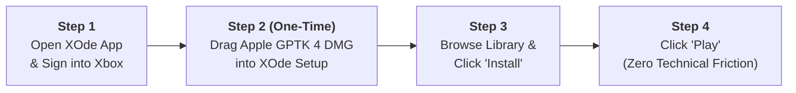
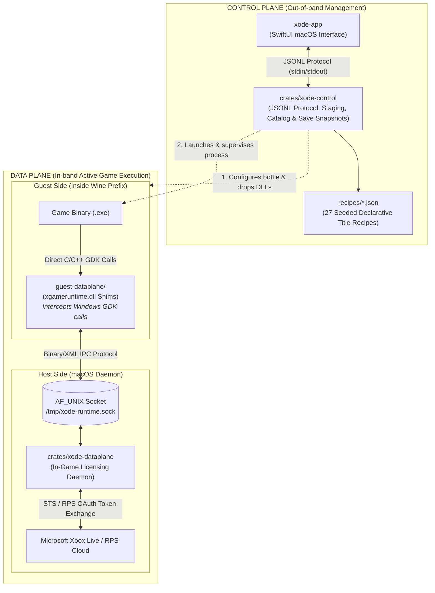

# XOde Platform Architecture & User Journey Consolidation

This document consolidates the complete architectural decisions, plane separation, repository roles, user recipe flow, and distribution strategy for the XOde platform and its predecessor Calimocho.

---

## 1. The End-User Recipe (Utmost Simplicity)

The design priority is that **the user should never know what a "shim", a "wine prefix", or a "DLL override" is**. Everything technical is automated.

Because licensing forbids bundling Apple Game Porting Toolkit 4 directly, onboarding includes **one transparent prerequisite step**:

### The 4-Step User Journey

1. **Sign In**: Launch `xode-app` and log in via the native Microsoft Xbox authentication sheet (hardware-backed in macOS Keychain).
2. **Provide Apple GPTK 4 (One-time setup)**:
   * Prompt the user with a 1-click link to Apple Developer to download the free `Game_Porting_Toolkit_4.dmg`.
   * User drags the DMG into XOde's onboarding window.
   * XOde mounts the DMG, extracts `D3DMetal.framework`, verifies its cryptographic integrity, unmounts, and stages it into `~/Library/Application Support/XOde/Engines/`.
3. **Install Game**: Select any entitled Game Pass game (e.g. *Subnautica 2*, *The Witcher 3*, *Forza*) and click **Install**.
   * `xode-control` downloads and decrypts `.msixvc` packages.
   * `xode-control` reads the title's recipe (`recipes/<STORE_ID>.json`) and configures the Wine prefix, dependencies (`vcrun2022`), and graphics overrides.
   * `xode-control` silently injects the verified GDK shim (`xgameruntime.dll`) into the bottle.
4. **Play**: Click **Play**. The game runs with full Apple Silicon D3DMetal graphics translation and live Xbox Live entitlement checks.

---

## 2. Platform Architecture: Two Planes, Four Components

The ecosystem is divided strictly into the **Control Plane** (out-of-band management) and the **Data Plane** (in-band active game runtime):

### Component Responsibility Matrix

| Component | Architecture Plane | Language & Host | Primary Duty |
| :--- | :--- | :--- | :--- |
| **[`xode-app`](file:///Users/dragoshont/src/xode-app)** | **Control Plane** | Swift (macOS) | Native UI: onboarding wizard, catalog browsing, download progress, game launch sheet. |
| **[`crates/xode-control`](file:///Users/dragoshont/src/xode-backend/crates/xode-control)** | **Control Plane** | Rust (macOS) | Package staging, anonymous catalog cache, Title Recipe generation tracking, save game snapshots. |
| **[`crates/xode-dataplane`](file:///Users/dragoshont/src/xode-backend/crates/xode-dataplane)** | **Host Data Plane** | Rust (macOS Daemon) | Listens on Unix socket, communicates with Microsoft RPS/STS servers, validates player entitlements. |
| **[`guest-dataplane/`](file:///Users/dragoshont/src/xode-backend/guest-dataplane)** | **Guest Data Plane (The Shim)** | C / C++ / IDL (Windows PE DLL) | Cross-compiled into `xgameruntime.dll` and placed in the bottle. Intercepts game calls thinking it is talking to Windows. |

---

## 3. Repositories & Roles

| Repository | Directory Path | Role & Scope |
| :--- | :--- | :--- |
| **`xode-app`** | `/Users/dragoshont/src/xode-app` | Native SwiftUI desktop user interface for macOS. Communicates with `xode-control` via JSONL. |
| **`xode-backend`** | `/Users/dragoshont/src/xode-backend` | The complete backend engine repository housing `xode-control`, `xode-dataplane`, `guest-dataplane/`, `xodus-cli`, and `recipes/`. |
| **`calimocho`** | `/Users/dragoshont/src/calimocho` | **Archived stopgap recipe for *Subnautica 2 on Steam***. Distributes zero binaries, uses zero shims, purely documents Porting Kit setup. |

---

## 4. Title Recipes & Save Protection

Rather than shipping multi-gigabyte pre-configured bottles, XOde uses declarative JSON recipes in [`recipes/*.json`](file:///Users/dragoshont/src/xode-backend/recipes):
* **27 Seeded Recipes**: Verified profiles for *The Witcher 3*, *No Man's Sky*, *Subnautica 2*, *Psychonauts 2*, *Hades*, *Skyrim SE*, *Fallout 4*, *Balatro*, *Dredge*, etc.
* **Save Snapshot Protection**: Every recipe carries a `generation` counter. If a recipe updates (e.g. from generation 1 to 2), the lifecycle engine automatically snapshots user saves (`Saved Games`, `AppData/Local`, `Documents`) to `~/Library/Application Support/XOde/save-backups/` before bottle rebuild, then restores saves into the updated prefix.

---

## 5. Shim Distribution & CI/CD Strategy

* **Calimocho**: **Never distributes the shim**. Steam games do not use Windows GDK.
* **XOde**:
  * **Legal Basis**: The shim source in `guest-dataplane/` is LGPL. Open-source clean-room reverse engineering permits distributing compiled binaries as long as the source is accessible.
  * **Current State**: Distributed as source in `guest-dataplane/`.
  * **Target Release State**: Built automatically in GitHub Actions CI/CD (`.github/workflows/release-runtime.yml`). Cross-compiles `xgameruntime.dll` and `xgameruntime_legacy.dll`, packages them into a checksummed release asset, and allows `xode-app` to silently download the verified bundle. The end user never touches a compiler.

---

## 6. Handoff to Next Session: Apple Game Porting Toolkit 4

Because Apple's SLA requires users to download GPTK directly with an Apple ID:
1. **Challenge to solve**: Design the smoothest possible user onboarding flow for acquiring and verifying `Game_Porting_Toolkit_4.dmg`.
2. **Key goals**:
   * Minimum clicks for the user.
   * Clear, automated DMG mount, checksum validation, and `D3DMetal.framework` extraction into the XOde engine directory.
   * Robust error handling if a user provides an incorrect or corrupted DMG.
